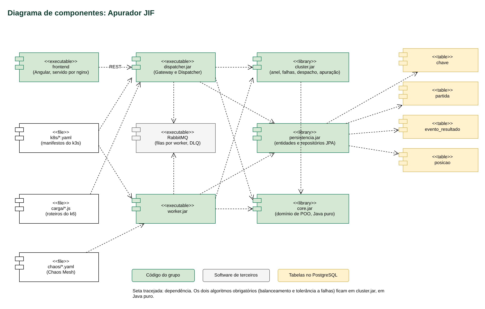
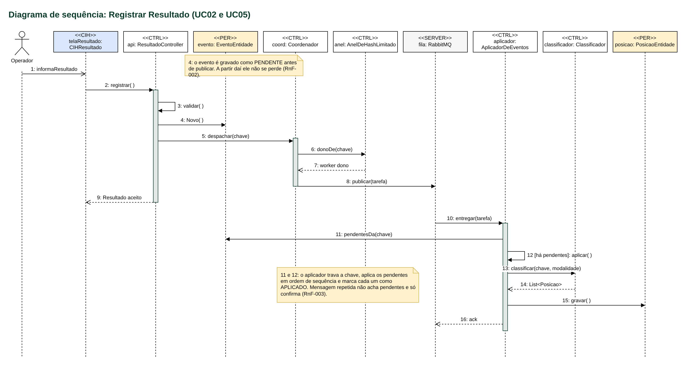
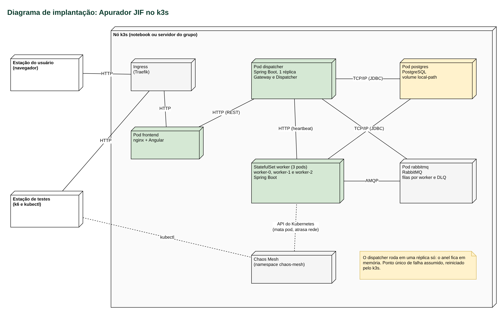
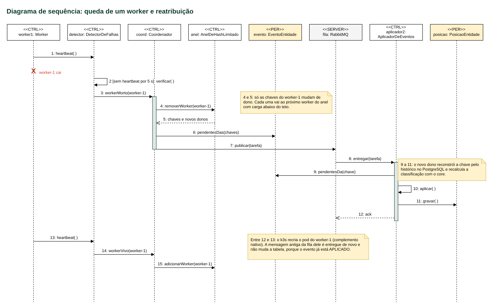
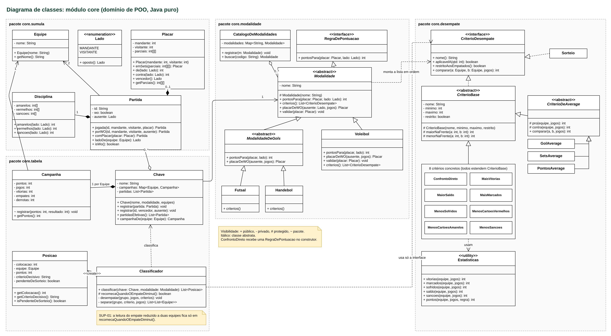
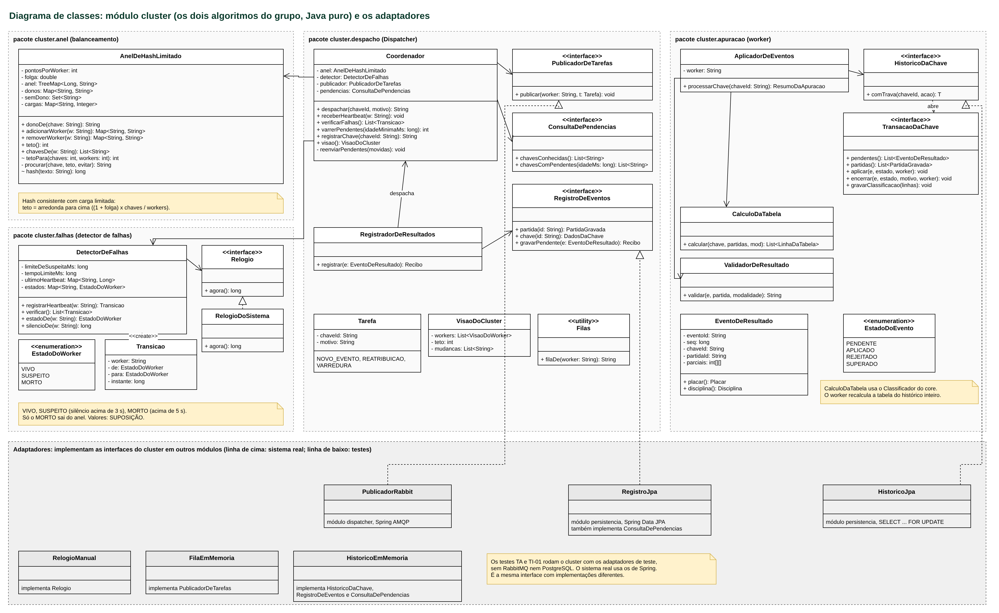
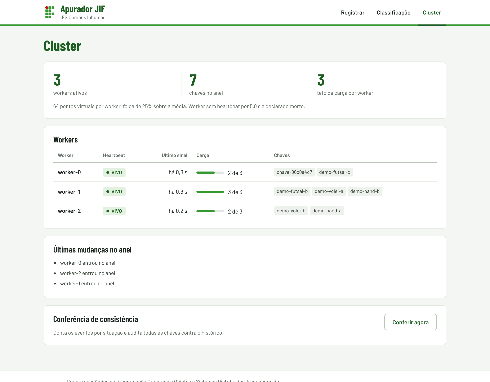
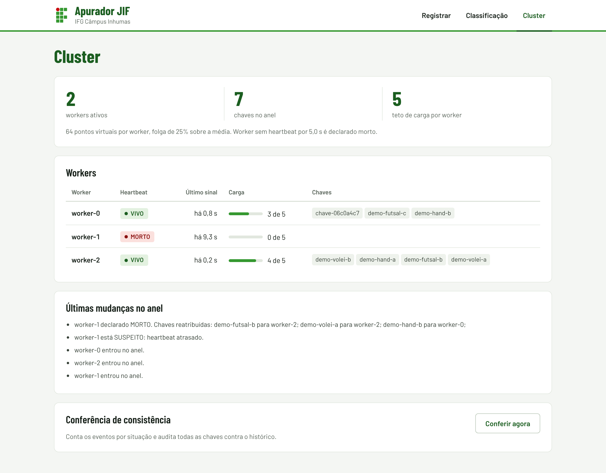

# Relatório técnico: Apurador JIF

Trabalho final de Programação Orientada a Objetos e de Sistemas Distribuídos.
Equipe: Maycon Douglas da Silva, Felype de Moura Lino e Silva, Maria Eduarda Mendonça Fernandes. IFG Câmpus Inhumas, Engenharia de Software.

Os diagramas aparecem reduzidos neste relatório. Cada um está em página inteira em `documentos/fase-0-requisitos/04-diagramas.pdf`, e o arquivo editável (.drawio) está em `docs/diagramas/`.

**Como ler este relatório.** Três marcas aparecem ao longo do texto. **SUPOSIÇÃO** é algo que assumimos por falta de informação e que o grupo precisa validar. **HIPÓTESE** é uma afirmação nossa sobre o uso do sistema, sem dado que a sustente. **A MEDIR** marca o que ainda não foi medido. **Fora do k3s** marca números medidos com o sistema inteiro rodando como processos locais, sem containers, em 17/11/2026. **No k3s** marca números medidos em 18/11/2026 no cluster do grupo, uma máquina virtual no MacBook Air do Maycon. Todo número de resultado deste relatório veio de uma execução real, e a seção 8 diz onde está a saída de cada um.

## 1. Introdução

Os Jogos das Instituições Federais (JIF) reúnem equipes dos institutos federais em várias modalidades. Na Etapa Nacional de 2026, sediada pelo IFG em Goiânia (Regulamento, Art. 5º), a fase classificatória das modalidades coletivas é disputada em chaves de três a cinco equipes, todas contra todas (Arts. 28 e 29). A classificação de cada chave depende de regras que mudam de modalidade para modalidade: a pontuação, o placar adotado no WO e a lista de critérios de desempate (Arts. 61, 62, 66, 67, 111, 112 e 113).

O regulamento prevê informativos e boletins diários (Art. 10, parágrafo único, VI; Art. 14, parágrafo único, III) e dá à instituição até 2 horas depois de uma partida coletiva para protestar (Art. 135, parágrafo único). A tabela precisa sair rápido e precisa explicar cada posição, porque é com ela na mão que alguém decide se protesta.

O **Apurador JIF** recebe os resultados, calcula a classificação pela regra da modalidade e mostra o critério que decidiu cada posição. O cálculo é o modelo orientado a objetos da proposta de POO. A parte de Sistemas Distribuídos é distribuir esse processamento entre vários processos e mantê-lo correto quando um deles falha.

**Escopo do MVP:** fase classificatória em chaves; futsal, voleibol e handebol; registro de resultado e de WO; classificação com o critério decisivo; retificação de resultado; painel do cluster. **Fora do escopo:** modalidades individuais, mata-mata, login e autenticação.

**HIPÓTESE:** os resultados chegam em rajada no fim das rodadas e muita gente consulta a tabela ao mesmo tempo. Não temos dado do JIF que sustente isso. Por isso o ganho que buscamos com a distribuição é disponibilidade e consistência, não desempenho: a conta de uma chave é leve.

## 2. Requisitos

Os requisitos completos estão em dois documentos: o documento de requisitos no modelo da disciplina de Análise e Projeto de Sistemas (`docs/00-requisitos/documento-de-requisitos.odt`) e a especificação complementar, com cada regra de negócio ligada ao artigo do regulamento e os critérios de aceitação em Gherkin (`docs/00-requisitos/especificacao-complementar.md`). A matriz de rastreabilidade liga cada requisito ao componente, ao teste e à seção deste relatório.

São 15 requisitos funcionais, 14 não funcionais e 15 regras de negócio. Os que definem a arquitetura são estes:

| Requisito | O que pede | Onde é atendido |
|---|---|---|
| RF-06 | Desempatar pela ordem de critérios do regulamento, por modalidade | `core`: `Classificador` e `CriterioDesempate` |
| RF-07 | Mostrar o critério que decidiu cada posição | `core`: `Posicao.criterioDecisivo` |
| RF-10 | Retificar um resultado e recalcular a chave | `cluster`: `AplicadorDeEventos` |
| RNF-01 | Continuar apurando quando um worker cai | `cluster`: detector de falhas e reatribuição |
| RNF-02 | Nenhum resultado aceito se perde | Evento gravado no banco antes da fila |
| RNF-03 | Nenhum resultado é aplicado duas vezes | Aplicação idempotente sob trava da chave |
| RNF-04 | Os eventos de uma chave são aplicados em ordem | Hash consistente: uma chave, um worker |
| RNF-05 | Nenhum worker passa do teto de carga | Hash consistente com carga limitada |

### 2.1 Lacunas do regulamento

O regulamento deixa pontos em aberto. Em cada um tomamos uma decisão, isolamos a decisão em um único lugar do código e escrevemos um teste que a fixa.

| Suposição | Lacuna | Leitura adotada | Onde está no código |
|---|---|---|---|
| SUP-01 | Empate de três que se reduz a dois: a lista de critérios recomeça? | Recomeça. O confronto direto volta a valer para as duas | `Classificador.recomecaQuandoOEmpateDiminui()` |
| SUP-02 | "Maior placar da fase dentro da chave" no WO do futsal e do handebol (Arts. 61 e 66) | O jogo com maior diferença de gols entre os que tiveram vencedor. Sem nenhum, 1 x 0 | `ModalidadeDeGols.placarDeWO` |
| SUP-03 | Como calcular o average | Pró dividido por contra, comparado por multiplicação cruzada. Contra zero fica na frente | `CriterioDeAverage.comparar` |
| SUP-04 | Quais jogos contam nas estatísticas do futsal | Todos os jogos da fase na chave | `Estatisticas` |
| SUP-05 | Sanções no handebol (Art. 67) | Soma das sanções em todos os jogos da fase | `Handebol.criterios` |
| SUP-06 | Sorteio | Acontece fora do sistema. A tabela marca "Sorteio pendente" | `Sorteio`, `Posicao.isPendenteDeSorteio` |
| SUP-07 | Estados de uma partida | O regulamento não define. Usamos AGENDADA, HOMOLOGADA e RETIFICADA | `EstadoDaPartida` |
| SUP-08 | Efeito do protesto aceito | O regulamento não define. Tratamos a retificação como hipótese de uso | `AplicadorDeEventos` |

### 2.2 O empate triplo: uma leitura nossa do regulamento

Este é o caso de teste obrigatório do trabalho, e ele mostra por que a SUP-01 importa. Chave de futsal com IFCE, IFG e IFSP: IFCE 4 x 1 IFG, IFG 3 x 1 IFSP, IFSP 4 x 3 IFCE. Cada equipe venceu uma vez e tem 3 pontos.

Com três equipes empatadas, vale a lista do Art. 62, § 2º, que não tem o confronto direto. O primeiro critério, vitórias, não separa ninguém (uma cada). O segundo, saldo de gols, separa: IFCE tem +2, IFG tem -1 e IFSP tem -1. O IFCE fica em 1º.

Sobram IFG e IFSP, empatados em -1. Aqui está a lacuna. Se a lista recomeça, as duas equipes passam a ser um empate de duas, vale o § 1º, e o primeiro critério é o confronto direto: IFG 3 x 1 IFSP, o IFG fica em 2º. Se a lista não recomeça, segue-se para o critério seguinte do § 2º, gols marcados: IFG fez 4 e IFSP fez 5, e o IFSP ficaria em 2º.

**As duas leituras levam a resultados diferentes. A leitura que recomeça a lista é uma escolha nossa**, e é por isso que ela está isolada em um método protegido. O teste `FutsalEmpateTriploTest` verifica a leitura adotada (IFCE, IFG e IFSP, com os critérios "Saldo de gols", "Confronto direto" e "Confronto direto") e, em uma subclasse que troca o método, a outra leitura (IFCE, IFSP e IFG, por "Gols marcados"). Se a comissão do JIF entender diferente, a troca é de uma linha.

## 3. Arquitetura



| Peça | Tecnologia | Papel |
|---|---|---|
| Interface | Angular | Registrar resultado, ver a classificação com o critério decisivo e acompanhar o cluster. Fala só com o Gateway, por REST |
| Gateway e Dispatcher | Spring Boot | Valida o resultado, grava o evento no PostgreSQL, escolhe o worker dono da chave no anel e publica a tarefa na fila dele. Recebe os heartbeats e reatribui chaves |
| Middleware | RabbitMQ | Uma fila quórum por worker, confirmação manual, dead letter exchange |
| Workers | Spring Boot | Consomem a própria fila, aplicam os eventos pendentes da chave e recalculam a tabela com o `core` |
| Banco | PostgreSQL | Eventos, partidas, posições. É o histórico que permite reconstruir qualquer chave |
| Domínio | Java puro (`core`) | Modalidades, critérios, classificador. Sem Spring |
| Algoritmos | Java puro (`cluster`) | Anel de hash com carga limitada, detector de falhas, coordenador, aplicador |
| VIM | k3s | Executa os containers, reinicia o que cai, expõe a interface pelo Traefik |

### 3.1 O caminho de um resultado



1. A interface envia `POST /api/resultados` com um `eventoId` gerado no navegador. O mesmo `eventoId` reenviado não cria outro evento.
2. O Gateway valida o resultado pela regra da modalidade. Resultado inválido volta com 422 e o motivo.
3. O Gateway grava o evento como PENDENTE, com um número de sequência do banco (`seq`). Só depois disso ele responde 202.
4. O Dispatcher pergunta ao anel quem é o dono da chave e publica na fila desse worker uma mensagem que diz apenas "esta chave tem eventos pendentes".
5. O worker recebe a mensagem, trava a linha da chave no banco, lê os eventos pendentes em ordem de `seq`, aplica cada um, recalcula a classificação inteira a partir das partidas gravadas e grava tudo na mesma transação.
6. Só depois de a transação terminar o worker confirma a mensagem (ack).
7. A interface consulta a classificação a cada 2 segundos.

### 3.2 Implantação no k3s



O Dispatcher roda como Deployment com uma réplica e estratégia `Recreate`, para nunca existirem dois anéis em memória. Os workers rodam como StatefulSet, porque o nome estável do pod (`worker-0`, `worker-1`, `worker-2`) é o identificador do worker no anel e o nome da fila dele. PostgreSQL e RabbitMQ rodam como StatefulSets com volume persistente. A interface é servida por um nginx que também repassa `/api` ao Dispatcher, e o Traefik, que já vem no k3s, faz o Ingress. Os manifestos estão em `k8s/` e o passo a passo da implantação do zero está no `README.md`.

## 4. Decisões e alternativas descartadas

| Decisão | Escolha | Por quê | Alternativa descartada e motivo |
|---|---|---|---|
| Middleware | RabbitMQ | Fila durável e replicada (quórum), ack manual, reentrega quando o consumidor cai, DLX. Pouca operação | **Kafka:** o volume de uma competição não justifica operar um log particionado; o histórico no PostgreSQL cumpre o papel do log. **gRPC direto:** acopla o Gateway à disponibilidade do worker |
| VIM | k3s | Kubernetes completo em um binário, roda em notebook, tem Ingress e o Chaos Mesh funciona nele | **Docker Swarm:** o Chaos Mesh só atua em Kubernetes. **OpenStack:** pesado demais para o hardware do grupo |
| Backend | Spring Boot | Spring AMQP, Spring Data JPA e Actuator resolvem a integração; o grupo já conhece Java | **Quarkus ou Micronaut:** ganho de memória que não muda o trabalho e custo de aprender outro framework |
| Interface | Angular | Exigida pelo grupo; tipagem forte com TypeScript | **Páginas do próprio Spring (Thymeleaf):** misturaria a interface com o Gateway |
| Balanceamento | Hash consistente com carga limitada, implementado por nós | Afinidade da chave com o worker e teto de carga (seção 5) | **Round-robin:** espalha os eventos da mesma chave. **Plugin de hash consistente do RabbitMQ, HPA, Spring Cloud LoadBalancer:** o enunciado pede o algoritmo do grupo |
| Tolerância a falhas | Heartbeat, reatribuição e reprocessamento idempotente, implementados por nós | Seção 6 | **Resilience4j, só probes do k3s:** reiniciam ou protegem chamadas, mas não reatribuem chaves |
| Ordem de gravação | Evento no banco antes da fila | Se a publicação falhar, o evento continua lá e a varredura reenvia | **Publicar direto na fila:** se o broker cair entre o 202 e a publicação, o resultado se perde |
| Conteúdo da mensagem | Só o id da chave | O worker lê os pendentes do banco. Mensagem repetida ou atrasada não faz mal | **Resultado inteiro na mensagem:** a ordem e a deduplicação ficariam por conta da fila |
| Filas | Uma por worker, um consumidor | A fila é a partição. Um consumidor com prefetch 1 mantém a ordem | **Fila única com consumidores concorrentes:** dois workers pegariam eventos da mesma chave ao mesmo tempo |
| Dispatcher | Uma réplica | O anel fica em memória | **Várias réplicas:** exigiriam combinar o anel entre elas (consenso), fora do escopo |
| Exclusão mútua por chave | Trava da linha no PostgreSQL (`SELECT ... FOR UPDATE`) | Já temos o banco; a trava some se o processo cair | **Trava distribuída (Redis, ZooKeeper):** mais uma peça para operar |
| Recalcular a tabela | Do histórico inteiro, a cada aplicação | Uma chave tem no máximo 10 jogos. O cálculo do zero não acumula erro | **Cálculo incremental:** mais rápido, mas uma retificação teria de desfazer contas |
| Atualização da interface | Polling a cada 2 s com ETag | Simples, passa por qualquer proxy, 304 quando nada mudou | **SSE ou WebSocket:** prenderiam conexões no Dispatcher, que é uma réplica só, e pediriam ajuste no nginx e no Traefik |

## 5. Algoritmo de balanceamento: hash consistente com carga limitada

### 5.1 Ideia

Workers e chaves ocupam posições em um anel de números de 64 bits. Cada worker aparece em vários pontos do anel (pontos virtuais), para a divisão ficar mais uniforme. A chave vai ao primeiro worker que aparece adiante da posição dela. Se esse worker já está no teto de carga, a chave pula para o próximo worker no anel. A carga de um worker é o número de chaves que ele tem.

O teto é calculado assim, com `c` chaves e `w` workers:

```
teto = max(1, arredonda_para_cima((1 + folga) × c / w))
```

Com folga de 0,25, nenhum worker passa de 25% acima da média. A técnica é de Mirrokni, Thorup e Zadimoghaddam (2018), que estenderam o hash consistente de Karger et al. (1997). **A implementação é nossa**, em Java puro, no pacote `cluster.anel` (classe `AnelDeHashLimitado`).

### 5.2 Pseudocódigo

```
posição(texto) = primeiros 8 bytes do MD5(texto)

donoDe(chave):
    se chave já tem dono: devolve o dono
    se não há workers: guarda a chave em semDono; devolve nada
    teto ← tetoPara(chaves + 1, workers)
    dono ← procurar(chave, teto)
    atribui chave a dono; devolve dono

procurar(chave, teto, evitar = nenhum):
    para cada ponto do anel, a partir de posição(chave), dando a volta:
        w ← worker do ponto
        se w já foi visto ou w = evitar: continua
        se carga(w) < teto: devolve w

adicionarWorker(novo):
    coloca pontosPorWorker pontos de novo no anel, em posição(novo + "#" + i)
    teto ← tetoPara(chaves, workers)
    para cada chave, na ordem de chegada, enquanto carga(novo) < teto:
        se o primeiro worker adiante da chave agora é novo: passa a chave para novo
    para cada worker acima do teto:
        repassa as últimas chaves que recebeu, com procurar(chave, teto, evitar = ele)
    atribui as chaves que estavam sem dono

removerWorker(saiu):
    tira os pontos de saiu do anel
    órfãs ← chaves de saiu
    teto ← tetoPara(chaves, workers restantes)
    para cada chave em órfãs: atribui a procurar(chave, teto)
    (as chaves dos outros workers não mudam de dono)
```

### 5.3 Por que não round-robin

Os resultados de uma mesma chave precisam ser aplicados por um único processo de cada vez e na ordem em que chegaram, porque a tabela depende de todos os jogos da chave. O round-robin manda o primeiro evento da chave A para o worker 1, o segundo para o worker 2 e assim por diante. Dois workers recalculariam a mesma tabela ao mesmo tempo. O hash consistente dá afinidade: a chave A vai sempre ao mesmo worker enquanto ele estiver vivo. O teto de carga resolve o defeito do hash consistente puro, que pode concentrar chaves em um worker por azar na posição dos pontos.

O teste `AnelDeHashLimitadoTest` tem um caso que mostra isso: o round-robin espalha os eventos da mesma chave por todos os workers, e o anel não.

### 5.4 Resultados medidos (em memória)

Saída real do teste TA-01 (`docs/03-relatorio/saida-dos-testes/cluster.txt`). São execuções do algoritmo em memória, sem rede, e por isso são exatas e repetíveis.

| Medição | Resultado |
|---|---|
| 3000 chaves em 3 workers, 1 ponto por worker, sem teto | Maior carga 1274 (média 1000) |
| 3000 chaves em 3 workers, 64 pontos por worker, sem teto | Maior carga 1136 (média 1000) |
| Entrada de um 4º worker com 60 chaves | 17 de 60 chaves mudaram de dono; o novo ficou com 17; teto 19 |
| Saída de um worker com 30 chaves em 3 workers | 8 de 30 chaves mudaram de dono, exatamente as 8 que eram dele |
| 500 operações aleatórias de entrada, saída e chave nova, folga 25% | Nenhum worker passou do teto em nenhum momento |

Os pontos virtuais reduzem a maior carga de 27% para 14% acima da média. A saída de um worker move só as chaves dele, que é a propriedade que deixa a recuperação barata.

**Calibração da folga e dos pontos virtuais no cluster: não feita.** A folga de 25% e os 64 pontos são SUPOSIÇÃO e foram os mesmos em todas as medições. O plano de testes pedia para variá-los no TC-01 e observar a maior carga e o número de chaves movidas. Isso não foi feito (seção 9).

## 6. Algoritmo de tolerância a falhas: detectar, reatribuir, reprocessar



### 6.1 Detectar: heartbeat com tempo limite

Cada worker envia um heartbeat ao Dispatcher a cada 1 segundo. O detector guarda o instante do último heartbeat de cada worker e, a cada verificação, classifica o worker pelo silêncio: VIVO, SUSPEITO (silêncio acima de 3 s) ou MORTO (acima de 5 s). Só o MORTO sai do anel. O estado SUSPEITO existe para o painel mostrar o atraso antes da decisão. É o detector de falhas por tempo limite descrito por Chandra e Toueg (1996): ele pode errar (declarar morto um worker que só está lento), e por isso a correção do sistema não pode depender de ele acertar.

```
registrarHeartbeat(w):
    último[w] ← agora
    anterior ← estado[w];  estado[w] ← VIVO
    se anterior ≠ VIVO: devolve a transição (anterior → VIVO)

verificar():
    para cada w com estado ≠ MORTO:
        silêncio ← agora − último[w]
        novo ← MORTO se silêncio > tempoLimite
               SUSPEITO se silêncio > limiteDeSuspeita
               VIVO caso contrário
        se novo ≠ estado[w] e novo ≠ VIVO: estado[w] ← novo; registra a transição
```

O relógio é uma interface (`Relogio`). Nos testes ela é um relógio manual, e por isso o teste do detector avança o tempo sem esperar.

### 6.2 Reatribuir

```
verificarFalhas():                               (a cada 1 s, no Dispatcher)
    para cada transição para MORTO do worker w:
        movidas ← anel.removerWorker(w)          (só as chaves de w mudam de dono)
        para cada (chave, novoDono) em movidas:
            publica Tarefa(chave, REATRIBUICAO) na fila de novoDono

receberHeartbeat(w):
    se w voltou ou é novo: movidas ← anel.adicionarWorker(w); publica as tarefas das movidas
```

### 6.3 Reprocessar sem duplicar

```
processarChave(chave):                           (no worker, ao receber a mensagem)
    numa transação, com a linha da chave travada (SELECT ... FOR UPDATE):
        pendentes ← eventos PENDENTES da chave, em ordem de seq
        se não há pendentes: termina (mensagem repetida ou atrasada)
        para cada evento:
            se é inválido: marca REJEITADO
            senão se a partida já tem resultado com seq maior: marca SUPERADO
            senão: grava o resultado na partida e marca o evento APLICADO
        se aplicou algum: recalcula a classificação do histórico inteiro e grava
    confirma a mensagem (ack) só depois de a transação terminar
```

Por que isso dá zero perdidos e zero duplicatas:

**Nada se perde.** O evento está no banco antes do 202. Se a publicação falhar, a varredura do Dispatcher (a cada 5 s, eventos pendentes há mais de 10 s) publica de novo. Se o worker cair antes do ack, o RabbitMQ entrega a mensagem de novo. Se o worker for declarado morto, o novo dono recebe uma tarefa de reatribuição.

**Nada se aplica duas vezes.** Marcar o evento como APLICADO acontece na mesma transação que grava o resultado. Ou as duas coisas acontecem, ou nenhuma. Uma mensagem repetida encontra o evento já aplicado e não faz nada. Se dois workers tocarem a mesma chave durante uma reatribuição (o antigo voltou, o novo assumiu), a trava da linha faz um esperar o outro. O `eventoId` é único no banco, então o mesmo envio feito duas vezes pela interface vira um evento só.

**A ordem se mantém.** Os pendentes são aplicados em ordem de `seq`, e um resultado mais antigo que chega depois de um mais novo é marcado SUPERADO, não sobrescreve.

Confirmação manual, dead letter exchange e as probes do k3s complementam esses três passos. Nenhum deles os substitui: a probe reinicia o pod, mas quem tira o worker do anel é o detector.

### 6.4 Resultados medidos

**Simulação em memória (TI-01).** O teste `SimulacaoDeFalhaTest` roda o Dispatcher, três workers, uma fila e um histórico em memória, com relógio manual, e derruba um worker no meio de uma rajada. Saída real:

| Medição | Resultado |
|---|---|
| Envios ao Gateway | 84 (80 eventos distintos e 4 reenvios) |
| Eventos aplicados | 80 |
| Perdidos | 0 |
| Aplicados mais de uma vez | 0 |
| Mensagens repetidas ou atrasadas ignoradas | 33 |
| Chaves do worker que caiu | 5, com 2 tarefas presas na fila dele |
| Da queda à reatribuição | 5400 ms de **tempo simulado** (tempo limite de 5000 ms mais o intervalo de verificação) |
| Maior carga com 2 workers vivos | 8 chaves, teto 8 |

O tempo de 5400 ms é do relógio manual da simulação, não de uma execução real. Ele confirma a lógica (a recuperação leva o tempo limite mais um intervalo de verificação), não o desempenho.

**Garantias da infraestrutura (TV-01).** O script `scripts/verificar-infra/verificar_infra.py` testou, em RabbitMQ 3.12.1 e PostgreSQL 16.15 de verdade, os comportamentos em que o desenho acima se apoia. Saída real (`saida-dos-testes/infra.txt`):

| Verificação | Resultado |
|---|---|
| V1. Mensagem sem ack volta para a fila quando o consumidor cai | Passou: a 2ª entrega veio marcada como reentregue |
| V2. Fila quórum com limite de entregas manda a mensagem para a DLQ | Passou: com limite 2, a mensagem foi entregue 3 vezes e foi para a DLQ |
| V3. `SELECT ... FOR UPDATE` faz a segunda transação esperar | Passou: a segunda esperou 1492 ms por uma trava de 1500 ms |
| V4. `eventoId` repetido é recusado | Passou: o segundo INSERT foi recusado |

A V2 trouxe um detalhe que vale registrar: com limite N, a mensagem é entregue N + 1 vezes antes de ir para a DLQ.

**Sistema inteiro, fora do k3s.** Em 17/11/2026 rodamos o Dispatcher e três workers como processos locais, com RabbitMQ 3.12.1 e PostgreSQL 16.15, numa máquina Linux de 2 vCPU e 7 GB, com os parâmetros padrão (tempo limite de 5 s). Durante uma rajada do k6, matamos com `kill -9` o worker que tinha mais chaves e o reiniciamos 2 s depois, como o StatefulSet faria. Saída real em `saida-dos-testes/medicoes-fora-do-k3s.txt`:

| Medição (a partir do kill -9) | Resultado |
|---|---|
| Worker passou a SUSPEITO | 3684 ms |
| Worker declarado MORTO e as 38 chaves dele com novo dono | 6026 ms |
| Worker reiniciado de volta ao anel | 17513 ms |
| Eventos aceitos na rodada / encontrados no banco / perdidos | 2174 / 2174 / 0 |
| Eventos aplicados mais de uma vez e chaves com tabela divergente | 0 e 0 |

Os 6026 ms batem com o desenho: 5 s de tempo limite mais até 1 s até a próxima verificação. Um efeito que só apareceu rodando de verdade: cada JVM do Spring Boot levou cerca de 32 s para subir com as quatro juntas, então o worker reiniciado sempre volta depois do tempo limite. No k3s isso se repetiu: o pod voltou depois de o worker ser declarado MORTO, e o caminho foi o da reatribuição, não o da mensagem voltando para o mesmo worker (tabela abaixo).

O teste de integração TI-02, com Dispatcher e dois workers de verdade, também passou (7 de 7). Com o tempo limite encurtado para 1500 ms, as 4 chaves do worker parado tiveram novo dono em 1651 ms, e a mensagem que sempre falha foi para a DLQ.

**No k3s, em 18/11/2026.** Repetimos as medições no cluster do grupo: uma máquina virtual Multipass de 4 CPUs e 8 GB (Ubuntu 24.04, k3s v1.37.2) num MacBook Air de 16 GB, com o Chaos Mesh 2.8.8 e o k6 v1.3.0 rodando dentro da própria VM. Os parâmetros são os mesmos das medições fora do k3s: heartbeat a cada 1 s, suspeita em 3 s, tempo limite de 5 s, folga de 25%, 64 pontos por worker, 40 resultados por segundo durante 60 s em 30 chaves, com 10% de reenvios. As saídas estão em `carga/resultados/k3s/`, `k3s-verificacao/` e `k3s-repeticao-tf02-tf02b-tf03-2/`, e cada pasta tem um `LEIA-ME.txt` dizendo o que vale e o que não vale. Os tempos abaixo vêm do observador `chaos/observar_cluster.py`, que lê o painel a cada 200 ms e estima a queda pelo último heartbeat recebido.

TF-01, o Chaos Mesh mata o worker-2 aos 25 s da rajada (`carga/resultados/k3s/`):

| Medição | Resultado |
|---|---|
| Worker passou a SUSPEITO | Silêncio de 3680 ms na primeira leitura em que saiu de VIVO |
| Worker declarado MORTO e as 19 chaves dele com novo dono | 5750 ms depois da queda estimada (±200 ms) |
| Pod de volta ao anel | Cerca de 10,4 s depois de o PodChaos ser aplicado, com 18 chaves |
| Eventos aceitos / encontrados no banco / perdidos | 2180 / 2180 / 0 |
| Latência do registro, p95 | 30,0 ms |

TF-02, o NetworkChaos atrasa em 300 ms (jitter de 100 ms) o tráfego dos três workers até o RabbitMQ por 60 s (`k3s-repeticao-tf02-tf02b-tf03-2/`):

| Medição | Resultado |
|---|---|
| Atraso que chegou ao tráfego (conexão TCP de cada worker ao RabbitMQ pelo Service) | 233 a 406 ms, contra 5 a 10 ms sem o atraso |
| Workers que saíram de VIVO | Nenhum |
| Eventos aceitos / encontrados no banco / perdidos | 2158 / 2158 / 0 |
| Latência do registro, p95 | 254,5 ms (máximo 2493 ms), contra 8,8 a 9,5 ms sem falha |
| Iterações que o k6 não conseguiu iniciar | 34 de 2401 |
| Tempo para a fila esvaziar depois da rajada | 4910 ms, contra 109 a 124 ms sem falha |

O atraso não perdeu nem duplicou nada e não fez o detector errar, mas custou latência no registro e tempo para a fila esvaziar. Não investigamos por que o registro fica mais lento se o atraso é só entre os workers e o RabbitMQ.

TF-02b, o NetworkChaos atrasa em 2,5 s (jitter de 1 s) o tráfego de um worker até o Dispatcher, que é o caminho do heartbeat, por 60 s (`k3s-repeticao-tf02-tf02b-tf03-2/`):

| Medição | Resultado |
|---|---|
| Atraso que chegou ao tráfego (conexão TCP ao Dispatcher pelo Service) | worker-0, o escolhido: 3131 a 3487 ms. worker-1 e worker-2: 5 a 7 ms |
| Worker passou a SUSPEITO | Silêncio de 3646 ms |
| Worker declarado MORTO e as 106 chaves dele com novo dono | 9803 ms depois da queda estimada (±200 ms) |
| Worker de volta ao anel | 60,6 s depois de o atraso começar, ou seja, quando ele acabou, com 106 chaves |
| Eventos aceitos / encontrados no banco / perdidos | 2196 / 2196 / 0 |
| Latência do registro, p95 | 9,1 ms |
| Tempo para a fila esvaziar depois da rajada | 147 ms |

Esse é o falso positivo que o desenho prevê. O cliente de heartbeat espera no máximo 800 ms pela resposta, então com 2,5 s de atraso o worker fica isolado do Dispatcher enquanto segue ligado ao RabbitMQ e ao PostgreSQL. O detector o declarou morto e reatribuiu as chaves dele, e mesmo assim nenhum evento se perdeu e a auditoria final não achou duplicata, porque a trava da chave e a idempotência não dependem do detector. Numa execução anterior, a primeira repetição, cujas rajadas não valem mas cujo observador valeu, o worker isolado foi declarado MORTO 5059 ms depois da queda estimada, com 63 chaves. Entre as duas execuções o tempo foi quase o dobro e não investigamos a diferença.

**O que deu errado antes de dar certo.** A primeira medição de TF-02 e TF-02b não valeu. O NetworkChaos mirava o IP dos pods, mas os workers falam com o RabbitMQ e com o Dispatcher pelo IP do Service, e o atraso não pega nesse caminho: medimos 5 a 7 ms pelo Service e 221 a 390 ms pelo IP do pod (`k3s-verificacao/atraso-medicao.txt`). O `describe` do Chaos Mesh mostrava "Injected" mesmo assim, porque ele só diz que a regra foi instalada. Passamos a mirar o IP do Service com `externalTargets` e a gravar, em cada execução, a prova do atraso medida a partir de cada worker. A primeira repetição também falhou por culpa nossa: a rodada reaproveitou os identificadores de evento da primeira medição, o banco subiu só 191, 205 e 181 eventos de 2400 envios e as rajadas não testaram nada. Hoje cada execução usa identificadores próprios e o resumo do k6 avisa quando um identificador é reaproveitado.

### 6.5 Limitação assumida: o Gateway é ponto único de falha

O Dispatcher guarda o anel em memória e roda em uma réplica. Se ele cair, ninguém registra resultado até ele voltar. Nenhum evento aceito se perde, porque o evento já está no banco. Ao voltar, o Dispatcher reconstrói o anel a partir dos heartbeats que voltam a chegar e das chaves gravadas, e a varredura reenvia o que estiver pendente. Mitigamos com reinício automático e probes do k3s. A evolução natural é eleição de líder entre duas réplicas (seção 10).

No k3s (TF-03, `carga/resultados/k3s-repeticao-tf02-tf02b-tf03-2/`) apagamos o pod do Gateway aos 20 s da rajada. O pod novo ficou pronto 10077 ms depois e respondeu de novo em 10365 ms. Nesse intervalo, 226 dos 2235 registros (10,1%) falharam e o k6 deixou de iniciar 165 iterações. Dos 1839 eventos aceitos, os 1839 estavam no banco e nenhum ficou pendente no fim. O p95 de 60000,9 ms é o limite de 60 s que o k6 espera por uma resposta: as requisições que pegaram o Gateway fora esperaram até ele estourar. Nas outras duas execuções do TF-03, uma com o script antigo e outra com identificadores reaproveitados, falharam 6,9% (157 de 2271) e 10,6% (224 de 2110) das requisições. Fora do k3s, com `kill -9`, foram 14,7%.

## 7. Aplicação dos conceitos de POO

O módulo `core` foi escrito para mostrar os conceitos de POO pedidos e não tem nenhuma dependência do Spring. Ele compila e roda os testes só com o JDK. O diagrama de classes está abaixo e a tabela diz onde cada conceito aparece.



| Conceito | Onde aparece | O que mostra |
|---|---|---|
| Classe abstrata | `Modalidade`, `ModalidadeDeGols`, `CriterioBase`, `CriterioDeAverage` | `Modalidade` declara `pontosPara`, `criterios` e `placarDeWO` como abstratos. Cada modalidade concreta responde do seu jeito |
| Interface com várias implementações | `CriterioDesempate`: 12 implementações (`ConfrontoDireto`, `MaisVitorias`, `MaiorSaldo`, `MaisMarcados`, `MenosSofridos`, `MenosCartoesVermelhos`, `MenosCartoesAmarelos`, `MenosSancoes`, `GolAverage`, `SetsAverage`, `PontosAverage`, `Sorteio`) | O `Classificador` só conhece a interface. A lista de cada modalidade é montada com objetos diferentes |
| Herança | `Futsal` e `Handebol` estendem `ModalidadeDeGols`, que estende `Modalidade`. `GolAverage`, `SetsAverage` e `PontosAverage` estendem `CriterioDeAverage` | A pontuação 3, 1 e 0 e o WO por maior placar ficam uma vez só em `ModalidadeDeGols` (Arts. 61 e 66) |
| Polimorfismo | `Classificador.desempatar` chama `criterio.comparar(a, b, jogos)` sem saber qual critério é | Uma modalidade nova entra sem mudar o `Classificador` (teste TU-07 cria uma modalidade inventada) |
| Encapsulamento | Atributos privados em todas as classes. Nenhum setter público. `Campanha.registrar` é de pacote: só a `Chave` atualiza a campanha | A campanha de uma equipe só muda quando uma partida é registrada na chave |
| Modificadores de acesso | `public` na API, `protected` nos construtores das abstratas e no `recomecaQuandoOEmpateDiminui`, pacote em `Campanha`, `private` nos auxiliares | O método da SUP-01 é `protected` para a outra leitura ser testada em uma subclasse |
| Pacotes | `core.sumula`, `core.desempate`, `core.modalidade`, `core.tabela` | Súmula do jogo, critérios, regras por modalidade e cálculo da tabela ficam separados |
| Imutabilidade | `Placar`, `Posicao`, `Partida`, `Equipe` e `Disciplina` são `final` com campos `final`. `Placar.getParciais()` devolve uma cópia | Uma `Posicao` calculada não muda depois. O teste TU-06 altera por fora o array de parciais e o placar continua igual |
| Arrays | `Placar.parciais` é `int[][]` (sets do vôlei). `Disciplina` guarda cartões e sanções em `int[]` por lado | Cópia defensiva na entrada e na saída |
| ArrayList | `Classificador` monta a classificação e os blocos de empate em `ArrayList` | |
| Collection | `CriterioDesempate.comparar(Equipe, Equipe, Collection<Partida>)` | O critério recebe qualquer coleção de jogos: todos da chave ou só os jogos entre as empatadas |
| Map | `Chave` guarda `Map<Equipe, Campanha>`. `CatalogoDeModalidades` guarda `Map<String, Modalidade>` | Busca da campanha pela equipe e da modalidade pelo código |

O mesmo raciocínio aparece no módulo `cluster`, que usa interfaces para separar o algoritmo da infraestrutura (diagrama abaixo). `PublicadorDeTarefas`, `HistoricoDaChave`, `RegistroDeEventos`, `ConsultaDePendencias` e `Relogio` têm uma implementação de teste, em memória, e uma de produção, com Spring AMQP e Spring Data JPA. Por isso os testes dos dois algoritmos rodam em menos de um segundo, sem RabbitMQ nem PostgreSQL, e o mesmo código roda no sistema real.



## 8. Testes e resultados

### 8.1 Plano

| Nível | IDs | Ferramenta | Situação |
|---|---|---|---|
| Unitário do core | TU-01 a TU-07 | JUnit 5 | Executado: 37 testes, todos passando |
| Algoritmos | TA-01 a TA-04 | JUnit 5 com relógio manual | Executado: todos passando |
| Integração simulada | TI-01 | JUnit 5 com fila e histórico em memória | Executado: passou (41 testes no módulo `cluster`) |
| Infraestrutura | TV-01 | Python com RabbitMQ e PostgreSQL reais | Executado: 4 de 4 |
| Integração real | TI-02 | Spring Boot Test, RabbitMQ e PostgreSQL reais | Executado: 7 de 7 |
| Carga | TC-01, TC-02 | k6 | Executado fora do k3s (17/11/2026) e no k3s (18/11/2026) |
| Falha | TF-01, TF-03 | `kill -9` fora do k3s; Chaos Mesh e kubectl no k3s | Executado fora do k3s e no k3s |
| Falha | TF-02, TF-02b | Chaos Mesh | Executado no k3s. Não rodou fora dele |
| Manual | TM-01, TM-02 | Roteiro da demonstração e README | Pendente: sem registro de ensaio |

Os testes TU, TA e TI-01 rodaram primeiro com javac e o JUnit Console Launcher (`scripts/testar-sem-maven.sh`) e depois com Maven, em 17/11/2026, no Mac do grupo (`scripts/compilar-no-mac.sh`): o build dos sete módulos passou e os 78 testes também. O k6 e as quedas com `kill -9` rodaram em 17 e 18/11/2026, com os jars desse build. Em 23/11/2026 os módulos `persistencia`, `dispatcher` e `worker` foram reorganizados em camadas (controller, service, validator, mapper, repository), sem mudar a lógica. Depois disso, os 78 testes e o TI-02 foram executados de novo, em um Linux com JDK 21 e Maven, e passaram (TI-02: 7 de 7, saída em `saida-dos-testes/ti-02.txt`). Os números de carga e de falha das seções seguintes vêm das execuções anteriores a essa reorganização.

### 8.2 Resultados obtidos

Os números das seções 5.4 e 6.4 e da tabela 8.3 são todos os resultados quantitativos que temos. Repetindo o essencial:

| Teste | Resultado real | Natureza |
|---|---|---|
| TU-01 empate triplo | IFCE 1º por saldo de gols, IFG 2º e IFSP 3º por confronto direto | Unitário |
| TA-01 balanceamento | Nenhum worker acima do teto em 500 operações; a saída de um worker moveu só as 8 chaves dele | Em memória, exato |
| TI-01 queda de worker | 80 eventos, 0 perdidos, 0 duplicados | Simulado, tempo de relógio manual |
| TV-01 infraestrutura | 4 de 4 garantias confirmadas | RabbitMQ 3.12.1 e PostgreSQL 16.15 reais |
| TI-02 fluxo completo | 7 de 7, inclusive empate triplo, DLQ e queda de worker | Spring Boot, RabbitMQ e PostgreSQL reais |
| TC-01 e TF-01 | 0 perdidos e 0 duplicatas, com e sem `kill -9` em um worker | Sistema inteiro, fora do k3s |
| TC-01, TF-01, TF-02, TF-02b e TF-03 | 0 eventos aceitos perdidos em todas as rodadas válidas. Auditoria final: 21524 eventos aplicados, 0 aplicados mais de uma vez, 0 chaves divergentes | No k3s, em 18/11/2026 |

### 8.3 Resultados medidos fora do k3s e no k3s

A coluna "Fora do k3s" vem de `saida-dos-testes/medicoes-fora-do-k3s.txt` e de `carga/resultados/`: processos locais, 2 vCPU, k6 na mesma máquina, rajada de 40 resultados por segundo durante 60 s, com 10% de reenvios de propósito, e 200 usuários virtuais consultando. A coluna "No k3s" vem de `carga/resultados/k3s/`, `k3s-verificacao/` e `k3s-repeticao-tf02-tf02b-tf03-2/`: VM de 4 CPUs e 8 GB num MacBook Air, k6 dentro da VM, os mesmos parâmetros de carga e 200 usuários virtuais na consulta. Com o k6 disputando a mesma CPU, as latências servem de linha de base, não de previsão para um cluster de verdade.

| Métrica | Meta | Fora do k3s (17/11/2026) | No k3s (18/11/2026) |
|---|---|---|---|
| Eventos perdidos, rajada sem falha (TC-01) | 0 | 0 de 2159 aceitos | 0 de 1915, 0 de 2188 e 0 de 2176 aceitos, em três rodadas |
| Eventos perdidos, rajada com worker morto (TF-01) | 0 | 0 de 2174 aceitos (`kill -9`) | 0 de 2180 aceitos (Chaos Mesh) |
| Duplicatas na tabela final, nas mesmas rodadas | 0 | 0 aplicados duas vezes, 0 chaves divergentes | 0 e 0, na auditoria com 21524 eventos aplicados em 306 chaves |
| Tempo de recuperação depois da queda de um worker | Definir depois da linha de base | 6026 ms do `kill -9` às chaves com novo dono | 5750 ms da queda estimada às chaves com novo dono |
| Latência do registro, p95 (TC-01) | Definir depois da linha de base | 15,0 ms sem falha; 36,4 ms com a queda | 8,8 e 9,5 ms em duas rodadas sem falha; 6138 ms na primeira rodada, não explicado; 30,0 ms com a queda |
| Latência da consulta, p95 (TC-02) | Definir depois da linha de base | 5,9 ms, 0% de falhas, 7585 consultas | 8,0 ms, 0,00% de falhas, 7565 consultas |
| Maior carga de um worker | Menor ou igual ao teto | 38 chaves com teto 38, no momento da queda | Não medido |
| Perdidos com rede lenta (TF-02 e TF-02b) | 0 | Não medido | 0 de 2158 e 0 de 2196 aceitos |
| Falsos positivos do detector com rede lenta | 0 em rede normal | Não medido | Atraso de 300 ms até o RabbitMQ (TF-02): nenhum worker saiu de VIVO. Atraso de 2,5 s até o Dispatcher (TF-02b): o worker isolado foi declarado MORTO, em 9803 ms |
| Tempo até o Gateway voltar (TF-03) | Definir depois da linha de base | 9296 ms; 14,7% das requisições recusadas enquanto ele estava fora; 0 eventos aceitos perdidos | 10077 ms até um pod novo ficar pronto (10365 ms até responder); 10,1% das requisições falharam; 0 de 1839 eventos aceitos perdidos |

Não definimos metas de latência: o plano pedia para defini-las depois da linha de base, e as medições acima são essa linha de base.

O "0" da coluna Meta continua sendo meta. Os zeros das colunas de medição são resultados dessas rodadas, nesse ambiente.

O uso de recursos durante duas rodadas sem falha no k3s (`kubectl top pods` a cada 5 s, maior valor lido de cada pod, `k3s-verificacao/recursos-durante-tc01.txt`): Dispatcher 244m de CPU e 396 MiB, PostgreSQL 98m e 97 MiB, RabbitMQ 112m e 167 MiB, cada worker entre 42m e 83m e perto de 370 MiB. O RabbitMQ não registrou alarme de recurso depois de nenhuma das duas rodadas.

**Um p95 que não se repetiu.** Na primeira rodada do TC-01 no k3s o p95 foi de 6138 ms (máximo de 10154 ms) e o k6 deixou de iniciar 301 iterações, mas nenhum evento se perdeu. Nas duas repetições sem falha o p95 foi de 9,5 e 8,8 ms. Não identificamos a causa. A hipótese é que a primeira rodada pegou o sistema ainda frio, e ela continua só como hipótese: não a testamos.

**Um "perdido: 1" que era erro de medição.** Na primeira execução do TF-03 o k6 contou 1 evento perdido. Era uma consulta de conferência que expirou durante a queda do Gateway e foi contada como ausência. O banco tinha subido exatamente os 1924 eventos aceitos. O k6 agora repete a conferência até três vezes e conta à parte as que continuam sem resposta (nas rodadas válidas, zero).

### 8.4 O painel do cluster durante uma queda

Capturas da interface Angular rodando contra o sistema real, em 18/11/2026, com sete chaves. Na primeira, os três workers vivos. Na segunda, 8 s depois do `kill -9` no worker-1: ele aparece como MORTO, e as três chaves dele passaram para o worker-0 e o worker-2. As capturas estão em `docs/04-apresentacao/telas/`.





No k3s, o painel passou pela mesma sequência (VIVO, SUSPEITO, MORTO e VIVO de novo) durante o TF-01 e o TF-02b. Os instantes estão na seção 6.4, lidos do mesmo endpoint que alimenta o painel.

Os números do k3s já estão nas seções 6.4 e 8.3. A Ata 004 (revisão pós-testes) é do grupo: data, presença e o que foi decidido a partir desses números.

## 9. Limitações

- **Gateway como ponto único de falha.** Discutido na seção 6.5.
- **Uma instância de PostgreSQL e de RabbitMQ.** A fila quórum só tem réplica com três nós do RabbitMQ. Com um nó, a durabilidade vem do disco, não da replicação. O manifesto pode subir três nós, mas não testamos essa configuração.
- **Ambiente de medição.** O cluster foi uma VM de 4 CPUs e 8 GB num MacBook Air, com o k6 dentro da própria VM. As latências são linha de base e variam: o TC-01 teve uma rodada com p95 de 6138 ms que não se repetiu e cuja causa não identificamos. Ficaram sem medir a calibração da folga e dos pontos virtuais, a maior carga de um worker no cluster, o TF-02 com atrasos maiores que 300 ms e o RabbitMQ com três nós. Cada experimento do Chaos Mesh tem uma execução válida. O TF-03 tem três, com 6,9%, 10,6% e 10,1% de requisições falhas, e o TF-02b tem duas observações do detector.
- **Falso positivo por desenho no TF-02b.** O cliente de heartbeat espera 800 ms pela resposta. Com 2,5 s de atraso o worker isolado foi declarado MORTO (em 9803 ms e em 5059 ms, nas duas execuções) enquanto seguia ligado ao RabbitMQ e ao PostgreSQL. Nenhum evento se perdeu, mas houve reatribuição desnecessária de 106 e de 63 chaves.
- **O `describe` do Chaos Mesh não prova o atraso.** Ele mostra "Injected" mesmo quando o tráfego não é atrasado. Só vale o atraso medido a partir de um worker (`tf02-prova-do-atraso.txt`).
- **RabbitMQ reinicia uma vez na primeira subida.** O `rabbitmq-0` aparece com `RESTARTS 1` em todas as listagens de pods, desde a primeira. Não investigamos a causa e o sistema funcionou depois dele.
- **Subida lenta da JVM.** Fora do k3s, cada processo do Spring Boot levou cerca de 32 s para subir com os quatro juntos. No k3s, o pod novo do Gateway ficou pronto em cerca de 10 s. Isso não afeta a correção, mas é o tempo em que o Gateway ou um worker reiniciado fica fora.
- **Detector por tempo limite.** Pode declarar morto um worker que só está lento. A correção não depende dele (a trava da chave e a idempotência cobrem o caso), mas um falso positivo causa uma reatribuição desnecessária.
- **Sem autenticação.** Qualquer pessoa com acesso à interface registra resultado. Está fora do escopo do MVP.
- **Leituras do regulamento.** As suposições SUP-01 a SUP-08 precisam ser confirmadas com a Comissão Técnica do JIF. A SUP-01 muda o resultado do caso de teste principal.
- **Sorteio fora do sistema.** A tabela marca a posição como pendente e não sorteia.

## 10. Trabalhos futuros

- Eleição de líder entre duas réplicas do Dispatcher (por exemplo, com um lease no próprio PostgreSQL ou no Kubernetes), com o anel reconstruído pelo novo líder.
- RabbitMQ com três nós para a fila quórum ter réplica, e PostgreSQL com réplica de leitura para as consultas.
- Fase de mata-mata e as modalidades individuais.
- Autenticação por perfil (mesário, comissão, público) e trilha de auditoria de quem registrou cada resultado.
- Calibrar a folga e os pontos virtuais com os dados reais de uma edição do JIF, se a comissão fornecer os horários das partidas.
- Exportar o boletim diário em PDF a partir das tabelas, que é o documento que o regulamento já prevê.

## 11. Referências

- COJIF. *Regulamento dos Jogos das Instituições Federais, Etapa Nacional 2026*. Goiânia, 2026. Disponível em: portal.redefederal.org.br. Consultado em 16/11/2026.
- MIRROKNI, V.; THORUP, M.; ZADIMOGHADDAM, M. Consistent Hashing with Bounded Loads. In: *Proceedings of the Twenty-Ninth Annual ACM-SIAM Symposium on Discrete Algorithms (SODA)*, 2018. arXiv:1608.01350.
- KARGER, D. et al. Consistent Hashing and Random Trees: Distributed Caching Protocols for Relieving Hot Spots on the World Wide Web. In: *Proceedings of the 29th ACM Symposium on Theory of Computing (STOC)*, 1997.
- CHANDRA, T. D.; TOUEG, S. Unreliable Failure Detectors for Reliable Distributed Systems. *Journal of the ACM*, v. 43, n. 2, 1996.
- COULOURIS, G. et al. *Sistemas Distribuídos: Conceitos e Projeto*. 5. ed. Bookman, 2013. Capítulos 6 (comunicação indireta) e 18 (replicação).
- TANENBAUM, A.; VAN STEEN, M. *Sistemas Distribuídos: Princípios e Paradigmas*. 2. ed. Pearson, 2007. Capítulos 4 (comunicação) e 8 (tolerância a falhas).
- RABBITMQ. Documentação: Quorum Queues, Consumer Acknowledgements and Publisher Confirms, Dead Letter Exchanges. rabbitmq.com/docs.
- KUBERNETES. Documentação: Configure Liveness, Readiness and Startup Probes; StatefulSets. kubernetes.io/docs.
- K3S. Documentação de instalação. docs.k3s.io.
- CHAOS MESH. Documentação: PodChaos, NetworkChaos. chaos-mesh.org/docs.
- GRAFANA LABS. Documentação do k6. grafana.com/docs/k6.
- POSTGRESQL. Documentação: Explicit Locking, row-level locks (`SELECT ... FOR UPDATE`). postgresql.org/docs/16.
- GUIMARÃES, N. F. *Modelagem Orientada a Objetos*, lições 0 a 4, e *Modelo de Documento de Requisitos 2024*. Material da disciplina de Análise e Projeto de Sistemas, IFG.
