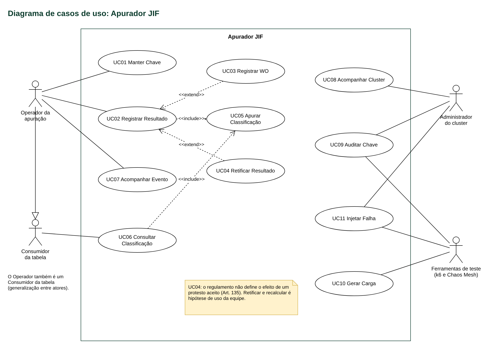
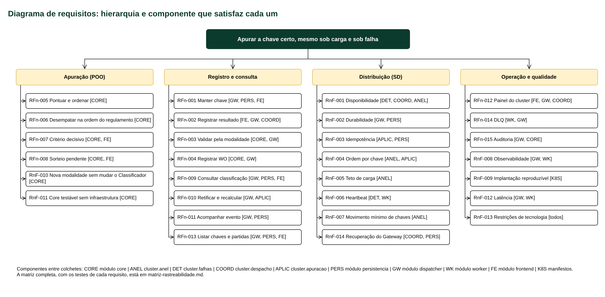
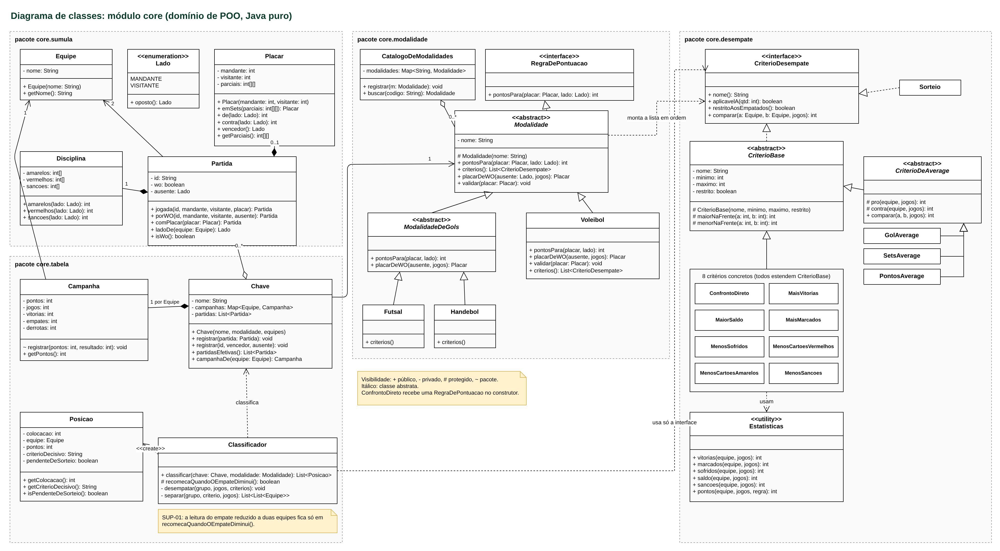
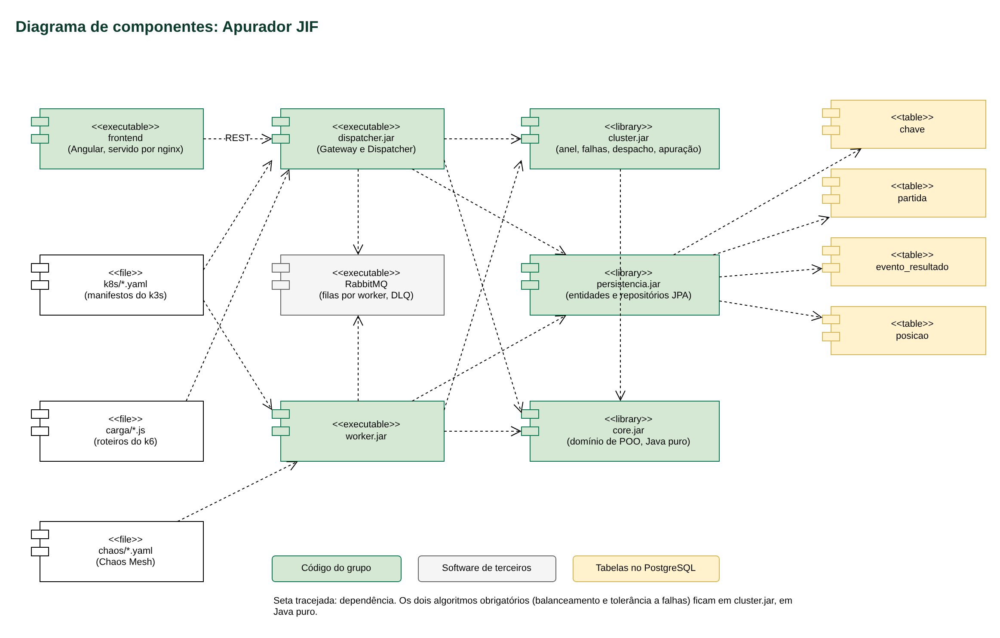
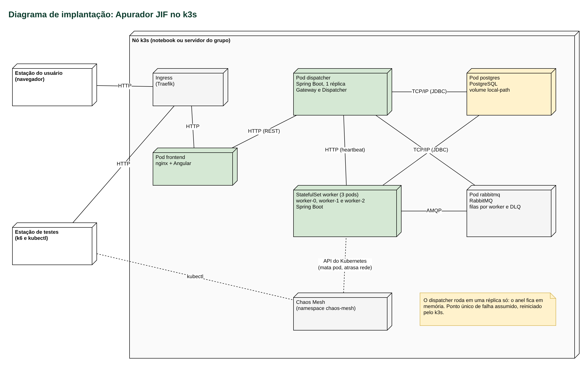
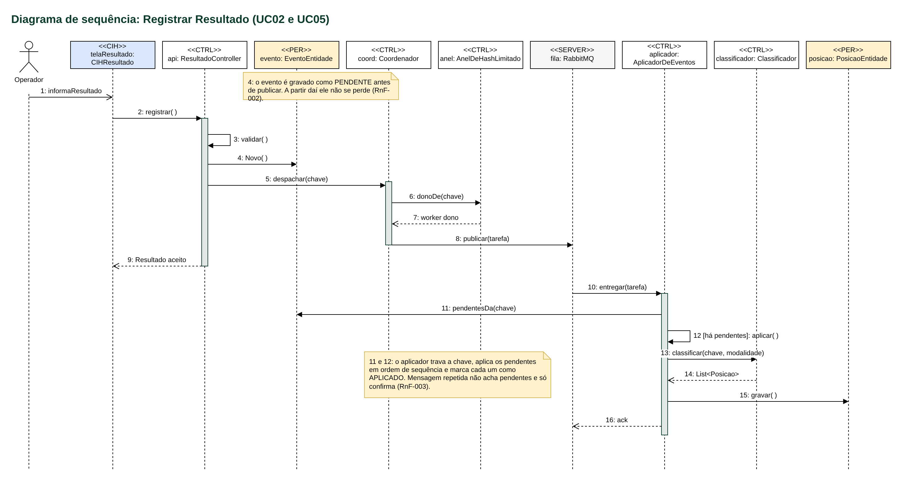
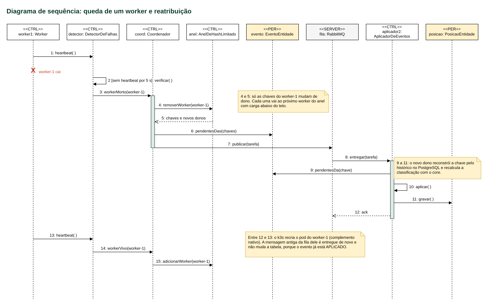
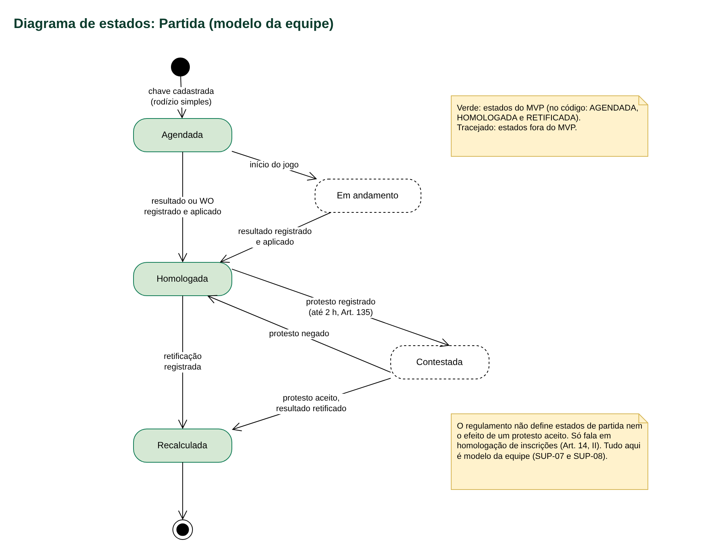
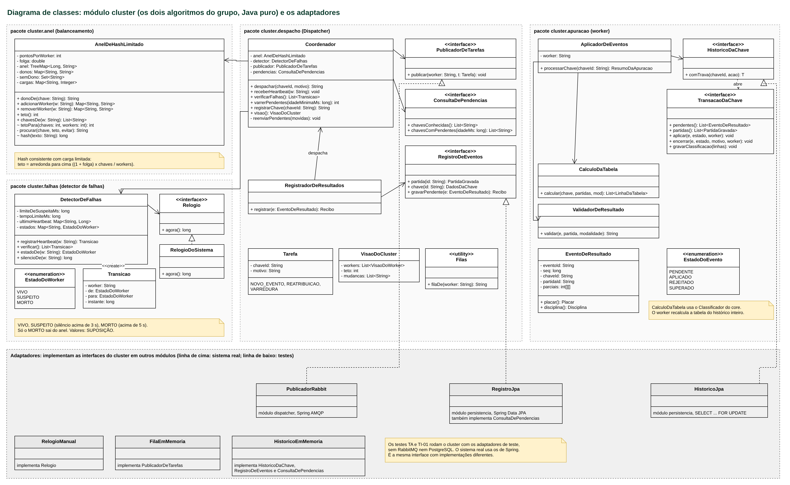

# Diagramas do Apurador JIF

Os diagramas seguem a notação das lições de Modelagem Orientada a Objetos da disciplina de Análise e Projeto de Sistemas e foram feitos para o draw.io.

Cada diagrama tem o arquivo-fonte (`.drawio`) e a imagem renderizada (`.png`). Para editar, abra o `.drawio` em app.diagrams.net ou no draw.io Desktop. Para atualizar a imagem, use Arquivo, Exportar como, PNG.

| # | Diagrama | Fonte | Lição | O que mostra |
|---|---|---|---|---|
| 1 | Casos de uso | `01-casos-de-uso.drawio` | Lição 1 | Atores, casos de uso, inclusão, extensão e generalização |
| 2 | Requisitos | `02-requisitos.drawio` | complemento | Hierarquia dos requisitos e o componente que satisfaz cada um |
| 3 | Classes do core | `03-classes-core.drawio` | Lição 3 | Classes, atributos, métodos, visibilidade, associações e multiplicidade |
| 4 | Componentes | `04-componentes.drawio` | Lição 4 | Componentes com estereótipo (executable, library, table, file) e dependências |
| 5 | Implantação | `05-implantacao-k3s.drawio` | Lição 4 | Nós e associações com o protocolo de cada ligação |
| 6 | Sequência do registro | `06-sequencia-registro.drawio` | Lição 2 | Objetos com estereótipo (CIH, CTRL, PER, SERVER) e mensagens numeradas |
| 7 | Sequência da queda | `07-sequencia-queda-worker.drawio` | Lição 2 | Detecção da falha, reatribuição e reprocessamento |
| 8 | Estados da partida | `08-estados-partida.drawio` | complemento | Modelo da equipe, o regulamento não define estados |
| 9 | Classes do cluster | `09-classes-cluster.drawio` | Lição 3 | Os dois algoritmos, o coordenador, o aplicador e as interfaces com mais de uma implementação (Fase 2) |

A pasta `plantuml/` guarda a primeira versão dos mesmos diagramas em texto (PlantUML). Ela não é mais a referência e pode ser apagada.

## 1. Casos de uso

## 2. Requisitos e rastreabilidade

## 3. Classes do core

## 4. Componentes

## 5. Implantação no k3s

## 6. Sequência: registrar resultado

## 7. Sequência: queda de um worker e reatribuição

## 8. Estados da partida

## 9. Classes do cluster

